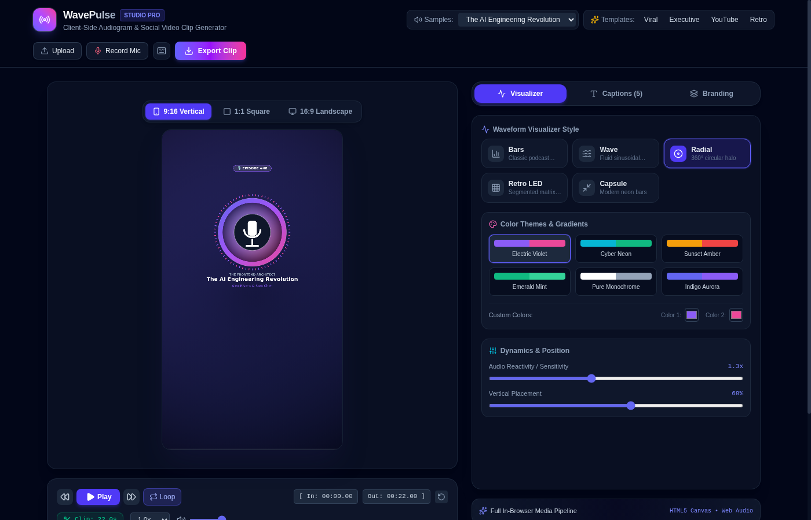

# WavePulse Studio

A client-side web application for generating video audiograms and social clips from audio files with real-time waveform visualizers and synchronized subtitles.



---

## Overview

WavePulse Studio is built entirely around browser-native APIs. All audio analysis, waveform rendering, subtitle synchronization, and video encoding execute client-side without relying on remote servers or FFmpeg backend workers.

## Key Features

* **Client-Side Media Pipeline**: Complete audio decoding, playback synchronization, and video compilation execute directly within the browser runtime.
* **Web Audio API Integration**:
  * Real-time frequency and time-domain analysis via `AudioContext` and `AnalyserNode` (512 FFT bins, 0.82 smoothing constant).
  * Built-in multi-track audio synthesis via `OfflineAudioContext` for instant local playback without external asset requests.
  * 16-bit PCM WAV audio slicing directly from decoded `AudioBuffer` data.
* **Canvas 2D Visualizer Engine (60 FPS)**:
  * Five configurable visualization modes: Frequency Bars, Continuous Wave, Radial Halo, Segmented LED Matrix, and Capsule Pulse.
  * Real-time parameter controls for frequency sensitivity, bar density, and vertical placement.
* **Synchronized Subtitles and Captions**:
  * Word-level timing detection and active word highlight animations.
  * Multiple visual styles including high-contrast outline, boxed card, and frosted capsule.
  * Interactive subtitle timeline editor supporting cue splitting, duration adjustments, and playhead snapping.
  * Parser and serializer for SRT and WebVTT subtitle files.
* **Multi-Aspect Ratio Layouts**:
  * Presets for 9:16 (vertical mobile video), 1:1 (square social posts), and 16:9 (horizontal widescreen).
  * Background customization supporting multi-stop CSS gradients, solid colors, and blurred album artwork backdrops.
* **Video and Audio Export**:
  * Hardware-accelerated canvas capture at 60 FPS using `HTMLCanvasElement.captureStream()`.
  * Audio multiplexing via `MediaStreamAudioDestinationNode`.
  * Video encoding using the `MediaRecorder` API with customizable bitrate settings.
  * Instant exports for 16-bit PCM WAV audio segments and high-resolution PNG cover frames.
* **Microphone Input**: Direct voice recording using the `MediaDevices` API (`getUserMedia`).
* **Keyboard Navigation**: Dedicated shortcuts for playback control, trim points, frame stepping, and aspect ratio toggles.

---

## Architecture

```
[ Audio Source: Upload / Microphone / Synthesizer ]
                         │
                         ▼
               ┌───────────────────┐
               │   AudioContext    │
               └─────────┬─────────┘
                         │
        ┌────────────────┴────────────────┐
        ▼                                 ▼
┌───────────────┐               ┌───────────────────┐
│ AnalyserNode  │               │    MediaStream    │
│  (FFT Data)   │               │  AudioDestination │
└───────┬───────┘               └─────────┬─────────┘
        │                                 │
        ▼ (60 FPS)                        │
┌───────────────┐                         │
│ Canvas 2D     │                         │
│ (Render Loop) │                         │
└───────┬───────┘                         │
        │ captureStream(60)               │
        ▼                                 ▼
┌───────────────────────────────────────────────┐
│                 MediaRecorder                 │
│             (WebM / MP4 Encoding)             │
└───────────────────────┬───────────────────────┘
                        ▼
            [ Downloadable Video Clip ]
```

---

## Technology Stack

* **UI Framework**: React 19, TypeScript
* **Styling**: Tailwind CSS v4
* **Build System**: Vite 8, Bun
* **Icons**: Lucide React
* **Browser APIs**:
  * Web Audio API (`AudioContext`, `AnalyserNode`, `OfflineAudioContext`, `MediaStreamAudioDestinationNode`)
  * HTML5 Canvas 2D API
  * MediaStream Recording API (`MediaRecorder`)
  * MediaDevices API (`getUserMedia`)

---

## Getting Started

### Prerequisites

* [Bun](https://bun.sh) (recommended) or [Node.js](https://nodejs.org) (v18+)

### Installation

```bash
# Clone the repository
git clone git@github.com:hamzaihsan9/audiogram-studio.git
cd audiogram-studio

# Install dependencies
bun install

# Start development server
bun dev
```

The application will be accessible at `http://localhost:5173`.

### Production Build

```bash
# Type check and generate production bundle
bun run build

# Preview production build locally
bun run preview
```

---

## Keyboard Shortcuts

| Key | Description |
| :--- | :--- |
| `Space` | Play / Pause audio playback |
| `[` | Set trim start marker to current playhead position |
| `]` | Set trim end marker to current playhead position |
| `Left Arrow` | Step playhead backward 2 seconds |
| `Right Arrow` | Step playhead forward 2 seconds |
| `L` | Toggle loop playback within trimmed region |
| `M` | Mute / Unmute audio |
| `1`, `2`, `3` | Switch aspect ratio (9:16, 1:1, 16:9) |
| `?` | Show keyboard shortcuts modal |

---

## License

MIT License.
